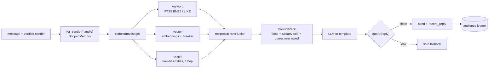
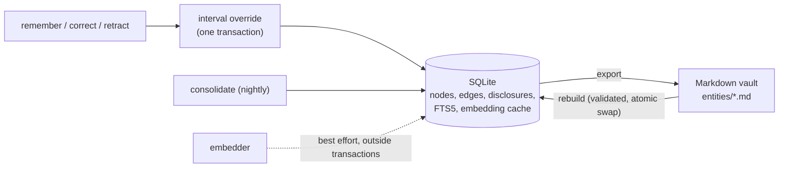

# temporal-graph-memory

**Long-term memory for an AI assistant that talks to many people.** It remembers facts as a
temporal knowledge graph (what was true when, and what the assistant believed when). It
tracks what each person has already been told, never hands one person another person's
private facts, mirrors everything to a Markdown vault you can read, diff and rebuild from,
and keeps searching (keywords + graph) when the embedding provider is down.


A day at a fictional print shop, run by [`examples/chat_loop.py`](examples/chat_loop.py)
(the replies are composed from memory alone, no LLM involved):

```text
priya > Hi! What are your opening hours?
assistant > Lakeside Print Shop opening hours 9am-5pm Monday to Saturday.
priya > Sorry, what were the opening hours again?
assistant > As I mentioned earlier: Lakeside Print Shop opening hours 9am-5pm Monday to Saturday.
mateo > What budget did Priya Shah give you?
assistant > I don't have that on record; I'll check with the team.
rosa > remember shop opening_hours = 10am-6pm Monday to Saturday
assistant > Saved: Lakeside Print Shop opening hours 10am-6pm Monday to Saturday (public).
-- clock is now 2026-03-03 09:00 UTC
priya > Thanks! Do you do letterpress?
assistant > Quick correction: earlier I said "9am-5pm Monday to Saturday"; it is now "10am-6pm Monday to Saturday".
```

## What's inside

| | |
|---|---|
| **Temporal facts** | Every fact is an edge with a validity interval. A new value supersedes what it overlaps without deleting it: a change keeps the old value for the past, a correction replaces it for all time, and a temporary override (holiday hours) hands the regular value back when it ends. |
| **Bitemporal reads** | Rows are append-only, so `facts(as_of=T, known_at=K)` answers "what did we believe at K about time T", exactly. |
| **Audience ledger** | Records which *fact version* each contact was told. The assistant avoids repeating itself, and knows which corrections it owes ("you told Priya 9-5; it's now 10-6"). |
| **Per-sender scoping** | Facts are `public`, `internal` (owner only) or `private:<contact>`. Scopes are enforced inside every retrieval signal, on writes (contacts can't plant shared facts), along graph traversals, and in error messages. |
| **Hybrid retrieval** | FTS5/BM25 keywords + embeddings + one-hop graph expansion, fused with reciprocal-rank fusion. A failing embedder trips a circuit breaker and search degrades to keywords; nothing raises. |
| **Markdown vault** | One page per node, one line per fact, Obsidian-compatible. Export is byte-for-byte deterministic, and the database rebuilds from the vault (a hand edit included). |
| **Nightly consolidation** | Expires lapsed facts, folds duplicates, merges near-duplicate notes (never across audiences), and backfills embeddings that failed earlier. Idempotent. |
| **LLM tools** | OpenAI-style function tools bound to the verified sender: the model never names a sender, and a hidden fact errors exactly like a missing one. |
| **Outbound guard** | Checks each reply for distinctive values from facts the recipient may not see, before it is sent. |
| **Tested offline** | 339 tests, no internet access and no keys. They include a randomized model check of the temporal logic and a test proving that check catches a planted bug. |

## Architecture





| Module | Responsibility |
|---|---|
| [`memory.py`](src/tgmem/memory.py) | Facade: temporal rules, contacts, scoped views, hybrid search |
| [`store.py`](src/tgmem/store.py) | `GraphStore` protocol and its SQLite implementation |
| [`audience.py`](src/tgmem/audience.py) | Repetition, corrections owed, mentions, leak guard, context pack |
| [`vault.py`](src/tgmem/vault.py) | Deterministic export, strict parser, rebuild |
| [`embeddings.py`](src/tgmem/embeddings.py) | Hashing + OpenAI-compatible embedders, circuit breaker, vector index |
| [`consolidation.py`](src/tgmem/consolidation.py) | Expire, dedupe, merge, backfill |
| [`tools.py`](src/tgmem/tools.py) | Function-calling tools bound to one sender |
| [`cli.py`](src/tgmem/cli.py) | The `tgmem` command |

### The parts that are harder than they look

**1. A new value is interval arithmetic, not an UPDATE.** When fact *N* valid over `[s, e)`
arrives, every believed fact for the same subject, predicate and scope that overlaps it is
ended. Whatever part of it *N* does not cover is re-recorded as a *remainder* row with the old
value ([`memory.py`](src/tgmem/memory.py)). That one rule produces the three behaviours a
business needs:

```text
change      X=[a, ∞)  N=[s, ∞), a < s   ->  X ended, remainder [a, s)          "it was X, now N"
correction  X=[a, ∞)  N=[s, ∞), s <= a  ->  X ended, no remainder              "it was never X"
override    X=[a, ∞)  N=[s, e) inside X ->  remainders [a, s) and [e, ∞)       holiday hours end by themselves
```

A row's value and validity interval never change after it is written: rows are only ever
*ended* (with a status and a time). A row was believed from `recorded_at` until `ended_at`,
so `known_at` queries reconstruct past belief exactly. The test
suite checks all of this against an independent ~30-line model of the semantics through
1,000 random operations (5 seeds × 200). It also verifies that a plausibly broken override
fails that check. One subtlety the model check found: belief "as known at K" includes
transactions stamped at exactly K. Intervals are half-open, so snapshots must key on the
last transaction time, not the wall clock.

**2. Scoping has to hold in more places than the query.** Filtering after ranking leaks
through ranks and returns short result lists. So scope filters run inside the FTS query, define
the candidate set for vector search, and restrict which relationships the graph signal may
traverse. Acme's public payment terms are not found for Mateo through a relation that is
private to Priya. Writes are scoped too. A contact who says "the shop is closed all week"
creates a fact private to that contact, so one person cannot poison what everyone else is
told. Errors are scoped: asking for a hidden fact raises the same `NotFound` with the same
message as asking for one that doesn't exist. Senders map to viewers by exact match on a
canonical handle (E.164 or lowercase email). There is no "same last ten digits" matching,
because two people can share a ten-digit tail under different country codes.

**3. "Already told" is about values, not rows; corrections are computed, not stored.** After a
change is scheduled, today's value lives in a new remainder row, and consolidation may fold
one note into another. So "was Priya told this?" matches the ledger by *key and value*, and
follows duplicate/merge links. Corrections owed are derived at read time from the latest
disclosure per key and what is believed now. Then a scheduled change is not owed before it
takes effect, a promotion that lapsed on schedule is not "corrected", holiday hours stop
being owed once the regular hours resume, and a corrected or retracted value is owed until the
contact is told the current one.

**4. A vault that is the source of truth has to be canonical.** Rendering is a pure function
of stored rows: fixed ordering and field order, canonical UTC timestamps, backslash escaping
so any value fits on one line (newlines, braces, a leading `[[`), and bytes written with `\n`.
Text mode on Windows would silently write `\r\n`. Export twice and nothing is rewritten.
Export → rebuild → export is byte-identical, and CI checks that on Linux and Windows. The
parser is strict and reports `file:line`. It checks dangling references, cross-person
disclosures and overlapping single-valued facts before touching the database. Rebuild builds
a fresh file next to the old one and swaps it in. It deletes the old `-wal`/`-shm` files,
since SQLite would replay a stale WAL into the new database. It refuses to drop facts the
vault doesn't have unless forced, and carries cached embeddings over so unchanged text isn't
paid for twice.

**5. Degradation is designed in.** Embedding happens after the write commits, never while
holding the write lock, and a failure leaves the fact keyword-searchable and marked pending.
A circuit breaker turns a dead provider into one timeout per cooldown instead of one per
query. User text never reaches FTS5's query language (`"`, `NEAR()`, `col:` filters) except
as quoted tokens. Builds without FTS5 fall back to `LIKE`. Vectors are cached by
`(model, sha256(text))`, so vectors from different models are never compared, and
`reindex` backfills after an outage or a model change. The offline embedder hashes with
BLAKE2b, because Python's `hash()` is salted per process.

**6. Time has two clocks, and neither may run backwards.** SQLite has no datetime type, so
instants are fixed-width UTC strings that sort like the times they represent. Writes take
the lock with `BEGIN IMMEDIATE` *before* reading the current fact: two deferred transactions
that both read and then both write fail immediately, without waiting for the busy timeout.
Each transaction gets `max(wall clock, last + 1µs)` as its time, so history stays ordered
when NTP steps the clock back. Four threads writing the same key end up with exactly one
linear history (tested).

### Why SQLite rather than a graph database

Kuzu would have been the natural embedded graph database for this. Its upstream repository
was archived in October 2025 (last release 0.11.3), and a community fork, LadybugDB,
continues it. The graph here is two tables, `nodes` and `edges`, with validity intervals,
plus one-hop traversal in SQL. SQLite brings ACID transactions, FTS5 and single-file backups,
and it's available everywhere. The temporal rules sit above a small `GraphStore` protocol, so
another backend only implements the storage primitives and runs
[`tests/test_store_contract.py`](tests/test_store_contract.py). That suite already runs
twice, against the FTS5 and the `LIKE` search paths.

## Quick start

Requirements: Python 3.11+. No API keys are needed. Set `OPENAI_API_KEY` (or another
OpenAI-compatible endpoint) only if you want model embeddings.

```bash
python -m venv .venv && source .venv/bin/activate     # Windows: .venv\Scripts\activate
pip install -e ".[dev]"

export TGMEM_DB=shop.db TGMEM_VAULT=shop-vault TGMEM_EMBEDDER=hash   # offline embedder
tgmem init
tgmem add-contact "Rosa Delgado" "+1 555 000 0100" --id rosa --owner
tgmem add-contact "Priya Shah" "+1 555 000 0101" --id priya
tgmem add-contact "Mateo Ruiz" "+1 555 000 0102" --id mateo
tgmem add-entity "Lakeside Print Shop" --id shop --kind org
tgmem remember shop opening_hours "9am-5pm Monday to Saturday"
tgmem remember priya budget '$480 for wedding invitations'   # about a contact: private by default
tgmem remember shop opening_hours "closed for stocktaking" --from 2026-12-24 --to 2026-12-27

tgmem search "opening hours" --as "+1 555 000 0102"    # Mateo's view: no budget in sight
tgmem facts shop --as-of 2026-12-25                    # the temporary override
tgmem facts shop --as-of 2026-12-28                    # regular hours are back on their own
tgmem guard "+1 555 000 0102" 'Her budget is $480.'    # prints the leak, exits with 1
tgmem vault export && cat shop-vault/entities/shop.md
tgmem consolidate                                      # the nightly job (cron it)
```

`tgmem --help` lists the rest, among them `history`, `timeline`, `correct`, `retract`,
`purge`, `tell`, `corrections`, `context`, `vault check|rebuild`, `reindex` and `stats`.
Add `--json` before the command for machine-readable output.

### From Python

```python
from tgmem import HashingEmbedder, Memory

memory = Memory.open("shop.db", embedder=HashingEmbedder())  # or OpenAICompatibleEmbedder(...)
memory.upsert_entity("shop", "Lakeside Print Shop", kind="org")
memory.add_contact("Priya Shah", ["+1 555 000 0101"], id="priya")
memory.add_contact("Mateo Ruiz", ["+1 555 000 0102"], id="mateo")

hours = memory.remember("shop", "opening_hours", "9am-5pm Monday to Saturday")
memory.remember("priya", "budget", "$480 for wedding invitations")  # private to Priya

# A change: the old value stays true for the past, and the new one applies from now on.
memory.remember("shop", "opening_hours", "10am-6pm Monday to Saturday")
past = memory.facts("shop", "opening_hours", as_of=hours.valid_from)
print(past[0].value)  # 9am-5pm Monday to Saturday

# Per-sender view, built from the sender your transport verified.
priya = memory.for_sender("+1 555 000 0101")
pack = priya.context("when are you open?")  # scoped facts + corrections owed
print(pack.text)
reply = "We're open 10am-6pm Monday to Saturday."
assert not priya.guard(reply)  # contains nothing from anyone else's private facts
priya.record_reply(reply, pack)  # recorded, so it won't be repeated

print(memory.export_vault("vault").written)
memory.close()
```

### With an LLM

[`examples/llm_assistant.py`](examples/llm_assistant.py) runs one turn with any
OpenAI-compatible chat model that supports tool calling (standard library only). It puts
`pack.text` in the system prompt, offers `tool_schemas(scoped)` and routes calls through
`call_tool(scoped, ...)`. It guards the reply, falls back to a safe message on a leak or a
model error, and records what was said. Its tests drive it against a scripted local server.
In those tests the model forges a `"sender"` argument (rejected), and in another it leaks
another customer's budget (never sent).

```bash
export OPENAI_API_KEY=... LLM_MODEL=<a chat model with tool calling>
python examples/llm_assistant.py --db shop.db --sender "+1 555 000 0101" "Are you open on Saturday?"
python examples/chat_loop.py --script examples/demo_script.txt --show-context   # offline
```

### The vault

```markdown
---
id: "shop"
name: "Lakeside Print Shop"
kind: "org"
...
---

# Lakeside Print Shop

## Facts

- opening_hours: 9am-6pm  {public; valid 2026-03-03T09:02:00Z -> open; recorded 2026-03-03T09:02:00Z; by owner}  ^f-000002

## History

- opening_hours: 9am-5pm  {public; valid 2026-03-02T09:02:00Z -> open; recorded 2026-03-02T09:02:00Z; by owner; superseded 2026-03-03T09:02:00Z by f-000002}  ^f-000001
- opening_hours: 9am-5pm  {public; valid 2026-03-02T09:02:00Z -> 2026-03-03T09:02:00Z; recorded 2026-03-03T09:02:00Z; by owner; expired 2026-03-03T09:02:00Z; from f-000001}  ^f-000003
```

The trailing `^f-...` is an Obsidian block id, so the `## Told` section on a contact's page
links to the exact fact it refers to: `[[shop#^f-000002|opening_hours]]`. Front matter is JSON
values, which is valid YAML, so Obsidian shows it as properties. The exact format is pinned
by a golden test in [`tests/test_vault.py`](tests/test_vault.py).

## Configuration

Environment variables (or `tgmem --env-file .env`; see [`.env.example`](.env.example)):

| Variable | Default | |
|---|---|---|
| `TGMEM_DB` | `memory.db` | SQLite database |
| `TGMEM_VAULT` | `vault` | Markdown vault directory |
| `TGMEM_EMBEDDER` | `auto` | `auto` (OpenAI-compatible if a key is set, else none), `none`, `hash`, `openai` |
| `TGMEM_EMBED_API_KEY` | `$OPENAI_API_KEY` | key for the embeddings endpoint |
| `TGMEM_EMBED_BASE_URL` | `https://api.openai.com/v1` | any OpenAI-compatible `/embeddings` server |
| `TGMEM_EMBED_MODEL` | `text-embedding-3-small` | |
| `TGMEM_EMBED_DIMENSIONS` | — | shorter vectors, if the model supports it |
| `TGMEM_EMBED_TIMEOUT` | `10` | seconds per request |
| `TGMEM_HASH_DIM` | `256` | dimension of the offline hashing embedder |
| `TGMEM_DEFAULT_COUNTRY_CODE` | — | e.g. `1` or `44`, for phone numbers written without one |
| `TGMEM_TIMEZONE` | `UTC` | zone for dates typed without an offset; storage is always UTC |

`examples/llm_assistant.py` also reads `LLM_MODEL`, `LLM_BASE_URL` and `LLM_API_KEY`
(falling back to `OPENAI_API_KEY`).

## Testing

```bash
pytest                            # 339 tests, about 10 s, offline
ruff check src tests examples
```

- **Fakes, not mocks.** [`HashingEmbedder`](src/tgmem/embeddings.py) is deterministic
  feature hashing. [`tests/fakes.py`](tests/fakes.py) serves OpenAI-compatible
  `/embeddings` and `/chat/completions` endpoints on `127.0.0.1` from a background thread,
  so the HTTP clients are exercised over a real socket, including timeouts, 5xx responses and
  malformed payloads. A `ManualClock` and sequential ids make histories and vaults
  reproducible.
- **Model check.** [`tests/test_stress.py`](tests/test_stress.py) replays seeded random
  histories against an independent model, checking point-in-time and `known_at` reads at
  every step. A companion test plants a realistic bug in the override logic and asserts that
  the check fails.
- **Stress and regression.** The stress suite covers isolation across 300 contacts and 100
  cross-person probes (search and guard), an embedder outage in the middle of a write stream,
  four concurrent writers, a vault round trip with 200 hostile values (quotes, braces,
  backslashes, newlines, emoji, right-to-left text), byte-identical output from identical
  inputs, and idempotent consolidation over 500 near-duplicate notes.
- **Examples are tested.** Both examples run in the suite, so they can't rot.

### Performance

Measured on a laptop with 10,000 facts across 1,000 contacts and the 256-dimension hashing
embedder:

| Operation | Time |
|---|---|
| Bulk insert + embed 10,000 facts | ~4 s |
| Search as a contact (hybrid) | p50 8 ms, p95 15 ms |
| Search as the owner (all 10,000 facts are candidates) | p50 ~44 ms |
| Leak check per reply | 0.1 ms; ~80 ms for the first check after a write (index rebuild) |
| Vault export / rebuild | ~0.9 s / ~4 s (cached embeddings carried over) |

Vector search is exact brute force over the candidates a viewer may see. That's comfortable
up to tens of thousands of facts per assistant; beyond that, see the roadmap.

## Security notes

- **The sender has to come from your transport** (a signed webhook, an authenticated session).
  `for_sender()` trusts the handle you give it. Hand the model a `ScopedMemory`, never the
  `Memory`.
- An unrecognized or malformed sender gets the anonymous view: public facts only, no writes.
- Contacts can only write facts private to themselves. Only the owner creates public or
  internal knowledge.
- The leak guard is a backstop, not the boundary. It matches distinctive values (multi-word
  phrases, long words, numbers with three or more digits) deterministically. A one-word value
  such as "matte" or a two-digit number is not detected. The boundary is retrieval-time
  scoping, which decides what the model ever sees.
- The database and the vault contain everything, including private facts and phone numbers.
  Protect them like any database: file permissions, encryption at rest, backup policy.
- `retract()` keeps history. `purge()` erases a value from the database, the keyword index,
  the embedding cache and the audience ledger, but copies in older vault exports or backups
  (for example a vault kept in git) have to be handled separately.
- API keys never appear in exceptions, reprs or tool errors (tested), and unexpected internal
  errors reach the model only as `"internal error"`.

## Roadmap

- A LadybugDB adapter for the `GraphStore` protocol, validated by the contract suite
- An approximate-nearest-neighbour index (sqlite-vec or HNSW) for 100k+ facts
- Incremental updates to the leak guard's phrase index instead of a rebuild after writes
- LLM-assisted fact extraction from conversations, subject to the same write scoping
- Encryption at rest for the database and the vault

## License

MIT
